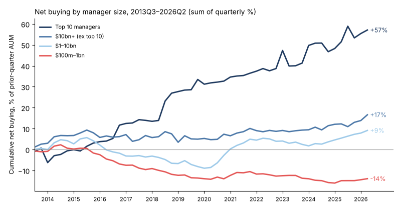

# 13F manager panel

**Question:** where is institutional money moving, and which managers are worth following?
This repo turns every SEC Form 13F filing since 2013 into a clean, per-manager quarterly panel to answer that.

**Scale:** 53 quarters (2013Q2–2026Q2) · ~8,800 filers and ~288,000 positions in the latest quarter · $75.7tn of reported long holdings.

## Findings so far

1. **Money keeps concentrating in the largest managers.** The top 10 were net buyers in 42 of 52 quarters, adding up to +57% of AUM over the period. Managers with $100m–1bn were net *sellers* in 33 of 52 quarters (−14%).
2. **Mid-size managers ($1–10bn) only turned net buyers after 2020.** They drifted into net selling from 2015 to early 2020, then recovered to +9%.
3. **2026Q2 was broad-based buying.** Every size tier was a net buyer, and SpaceX (Space Exploration Technologies) was the largest single buy in every tier.

*Net buying = change in shares held × quarter-end price, as a % of the manager's prior-quarter AUM. It strips out price moves, so it reflects decisions (client flows, rebalancing, conviction), not market performance. Tiers are re-set each quarter by AUM, and the chart sums quarterly percentages rather than compounding them.*

## Method (short)
- **Source:** SEC 13F bulk data sets, recorded with SHA-256 hashes in `data/manifest.json`.
- **Cleaning:** fixes for the pre-2023 $000s unit change, share-count copy errors, stock splits and filer aliases.
- **Features per manager:** AUM, number of positions, effective N, top-10 weight, active share, turnover, option notionals, and a *redemption signature* (trim breadth and dispersion), which detects managers selling across the book to meet outflows rather than by choice.
- **Candidates:** managers with $50m+ AUM, at most 200 positions and at most 50% in ETFs (3,696 in 2026Q2). These are the books concentrated enough to carry a signal.

## How it is checked
- `pipeline/audit.py` fails the build if any guardrail breaks: tier flows above 10% of AUM, total value moving more than 35% in a quarter, implausible filer size, or suspected unadjusted splits. The current audit passes.
- Holdings reconcile to filers' own cover-page totals: 99.0% match in 2026Q2, across 8,784 filings.
- Spot checks against figures from third-party sites (`data/checks/`), plus 12 unit tests.

## Limits
13F filings are quarterly and arrive up to 45 days after quarter end. They cover long US-listed positions only: no shorts, cash, bonds or non-US holdings. Options are reported as notional, not delta. Net buying cannot separate client flows from manager decisions.

*Built with AI assistance; the questions, design, checks and analysis are mine.*

## Data

GitHub Actions builds the dataset from the SEC Form 13F bulk data sets (2013Q2 onward). Outputs live in `data/`:

| Path | Contents |
|---|---|
| `data/features/<Q>.parquet` | One row per filer: AUM, positions, effective N, top-10 weight, ETF weight, active share, option notionals, flows, turnover, new/exit weight, trim breadth and dispersion (redemption signature), candidate flag |
| `data/holdings/<Q>.parquet` | Position-level books (with quarter-on-quarter change and status) for candidate managers: AUM >= $50m, <= 200 positions, ETF weight <= 50% |
| `data/prices/<Q>.parquet` | Per CUSIP: issuer, median implied quarter-end price, number of holders, total held |
| `data/checks/<Q>.json` | Pass/fail against figures transcribed from third-party sites |
| `data/manifest.json` | Quarters built, SEC source files with SHA-256, row counts, cover-page reconciliation |
| `data/dashboard/history.json` | Tier flows for the 13F Flow Monitor dashboard |

Run manually: Actions > build-13f > Run workflow (set `start` to `2013Q2` for the one-off backfill).
Values are in US dollars (pre-2023 filings, reported in $000s, are rescaled).
